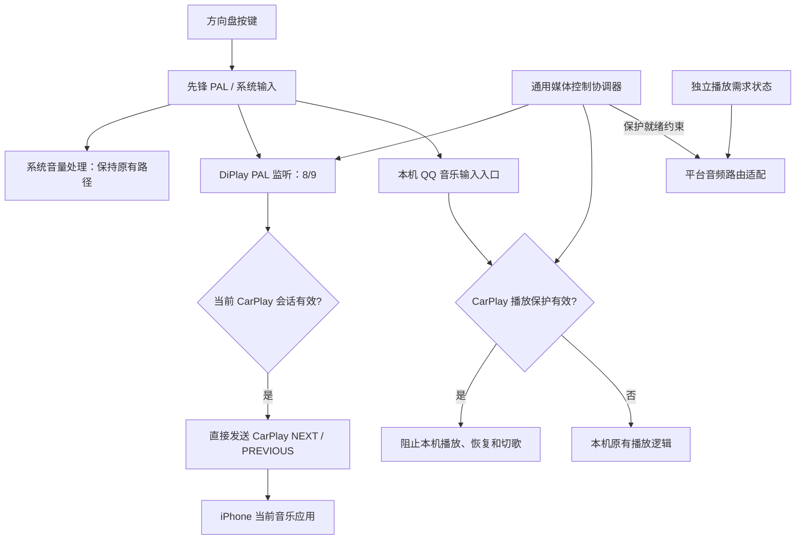

# 先锋车机 CarPlay 方控接管、播放器隔离与仪表歌曲信息同步方案

日期：2026-10-13。状态：修改方案，尚未实施或部署。

本次修订：明确连接、播放与保护的不同条件；补充音量触发播放的前置阻止；将通用策略与厂商、协议、播放器适配分离。新增类名均为设计名称，没有在本轮修改实现代码。

**最终确认的保护规则：CarPlay 实际连接成功即启用本机播放保护，实际断开连接即解除。**不以首次音频、是否正在播放或 Activity 是否在前台作为保护开关。方案保持这一种策略，不增加可选模式。

本版增加仪表同步：方控由 DiPlay 直接接入 PAL；仪表优先验证 DiPlay 直连系统仪表接口，已验证的 WeCarFlow 固定服务转发作为备选。具体设计见第十二节，直接对接候选见 12.10；本机播放器保护是另一项职责，不能因方控或仪表直连就视为已完成。

## 一、推荐结论

推荐采用 **DiPlay 接收 PAL 方控事件并直接控制 iPhone，本机 QQ 音乐在 CarPlay 会话期间拒绝自身播放与切歌** 的协作方案。

需要同时解决两个独立问题：

1. **输入转发：**先锋方控切歌不是普通 Android 87/88 事件，DiPlay 必须接入 PAL `CabinKeyEvent`。
2. **播放器隔离：**当前为了 CarPlay 出声复用了本机媒体音源 300；该音源仍可能让本机播放器响应方控或自动恢复。一次暂停不能保证它在整个会话期间不播放。

音量加减继续由先锋系统处理，保持现有有效的音量调节路径。切歌直接调用 DiPlay 现有 CarPlay 媒体 HID 发送能力，不向系统注入全局 87/88，也不广播全局媒体键。

**保护条件不能只等于“CarPlay 此刻正在播放音频”。**按当前“连接期间本机播放器不播放”的需求，应在真实会话激活时建立保护，在第一次选择媒体音源 / 输出音频之前确认保护生效，暂停、导航间隙和没有音乐时继续保持。音频开始用于激活必要的声音出口，不用于反复开启 / 解除本机保护。

**不能把 PAL“监听到按键”当成“独占按键”。**目前参考客户端的事件回调返回 `void`，没有已确认的消费返回值；其它客户端可能收到同一事件。因此，若只修改 DiPlay，不能承诺达到“本机播放器绝不响应或播放”的完整要求。推荐方案包含本机 QQ 音乐的有限保护修改，保留其车机平台服务和非 CarPlay 状态下的正常功能。

## 二、目标行为

### 2.1 分开管理三类条件

| 决策 | 依据 | 用途 |
| --- | --- | --- |
| 方控发送给谁 | 有效会话及当前控制目标 | 决定上一首 / 下一首发往 iPhone，音乐暂停时仍有效 |
| 是否禁止本机播放 | 播放保护策略及已确认的保护状态 | 当前默认策略覆盖整个活动会话，不随每次音频停顿解除 |
| 是否激活媒体声音出口 | 媒体播放意图 / 音频启动及可用路由 | 播放需要时选择媒体音源，避免仅连接就强行切掉 FM |

“开始播放”也要区分播放意图、音频流收到首包、解码得到 PCM 和实际播放进度增长。当前 `onMediaAudioChanged(true)` 表示有媒体类型的 renderer 启动，不代表已经听到声音；它不涵盖导航、助手等所有音频类型。不能直接把该布尔值作为统一的播放器保护条件。

保护必须先于可能唤醒本机播放器的音源激活和首段 PCM 输出；等待已经出声再暂停本机属于事后处理，仍可能串音。会话回调与音频工作线程存在先后竞态，需要由统一协调器的保护就绪状态约束相关操作，不能只依赖 Activity 中排队的一个回调。

本版只采用“连接即保护、断开即解除”。连接前允许本机正常播放；连接成功时暂停已有本机播放并阻止后续播放 / 切歌；音乐暂停、没有音频和导航间隙均保持保护。音频启动只影响声音出口激活，不改变保护生命周期。

### 2.2 行为矩阵

| 场景 | 音量加减 | 上一首 / 下一首 | 本机播放器 |
| --- | --- | --- | --- |
| CarPlay 已连接且正在播放 | 系统正常调节当前声音 | iPhone 当前播放器切歌，一次按下只切一首 | 不播放、不因方控恢复或切换本机歌曲 |
| CarPlay 已连接但 iPhone 音乐暂停 | 系统正常调节音量 | 仍发送给 iPhone，具体播放行为由 iPhone 应用决定 | 仍受保护，不接管按键 |
| CarPlay 仅导航或 DiPlay 在后台 | 系统正常调节当前声音 | 仍属于当前 CarPlay 会话 | 保持不播放 |
| CarPlay 正式断开或用户退出连接 | 系统原有行为 | 恢复本机正常处理 | 解除保护；不主动强制恢复音乐播放 |
| 无受支持的输入或播放器保护适配 | 原有行为 | 原有行为 | 不宣称已接管；明确能力不可用 |

范围首先覆盖已确认的本机音乐包 `com.tencent.wecarflow`。如后续实机确认还有独立 USB / 本地音乐播放器进程参与方控，需要把对应播放器纳入同一隔离规则，不能仅凭“QQ 音乐已保护”声称其它进程也已处理。

MODE 键不转发成 CarPlay 媒体键。第一版允许系统按原逻辑切换音源，但 CarPlay 活动期间本机音乐仍不能因音源切换开始播放。不持续轮询或强制把 FM / 蓝牙拉回媒体音源；从 FM / 蓝牙重新启动 iPhone 媒体播放时，再沿用已验证的媒体音源选择逻辑。

## 三、依据与当前代码差异

### 3.1 方控事件的已知实测结论

依据用户指定的记录：

`/Users/zhouhao/work/project/车载软件/qqmusic/docs/QQMusic方向盘切歌适配修改记录.md`

该记录确认：

| PAL 事件 | 含义 | CarPlay 指令 |
| --- | --- | --- |
| `kind=normal, keyCode=8, action=1` | 上一首 | `CarPlayMediaButton.PREVIOUS=5` |
| `kind=normal, keyCode=9, action=1` | 下一首 | `CarPlayMediaButton.NEXT=4` |

PAL 的 `action=1` 是该链路中实测可用的按下事件，不是 Android 的 `ACTION_UP=1`。不能将两个事件空间的 action 数值混用。

原 QQ 音乐适配是“PAL → QQ 音乐原生媒体键入口”。本次目标改为“PAL → 当前 CarPlay 会话”，不再把切歌事件送入 QQ 音乐。

### 3.2 DiPlay 已有能力与不足

- `CarPlayController.sendMediaButton(index)` 已有 CarPlay 媒体发送能力，无需重写媒体 HID 协议。
- `CarPlayHostActivity.dispatchKeyEvent()` 和 `CarPlayMediaCallback` 处理标准 Android 媒体事件，覆盖不到本次 PAL 输入源。
- `CarPlayMediaKeys` 已有厂商方控接入的先例，但目前是吉利输入服务，不是先锋 PAL。
- 当前 Android MediaSession 在媒体音频开始后才创建；暂停、仅导航、刚连接时不能据此管理先锋方控所有权。
- 当前媒体键层还会请求普通 `USAGE_MEDIA` 焦点；先锋音轨层已经持有厂商 401 焦点，需要避免再用一套标准焦点影响音源与音量行为。
- `PioneerAudioRouting.pauseSourcePlayer()` 只在媒体轨道激活后发一次暂停，无法阻止之后的音量操作、切歌或音源激活重新唤起本机播放。

用户本次反馈证明，之前“声音出口接通 + 一次暂停”的修复并没有完成整个会话期间的播放器隔离。

### 3.3 PAL 接口不能直接证明独占

参考客户端中的 `com.tencent.tai.pal.client.c$a` 提供：

```text
a(CabinKeyEvent): void      长按回调
b(CabinKeyEvent): void      普通回调
i(): KeyFilter             监听过滤条件
```

当前看到的 manager 接口只明确暴露注册方法，尚未确认移除监听或独占分发接口。实现时不能凭空调用假定存在的 unregister，也不能认为缩小 KeyFilter 就可以屏蔽其它客户端。

本轮规划时 `adb devices` 无在线设备，因此这些问题只能先依据源码与历史记录设计，不能宣称已经完成新的实机验证。

## 四、可选方案比较

| 方案 | 优点 | 局限 | 结论 |
| --- | --- | --- | --- |
| 只改 DiPlay：PAL 转发 + 再次暂停本机播放器 | 改动少，可很快验证 CarPlay 切歌 | 本机可能先播放再暂停；可能照样切换本机歌曲；不保证零串音 | 可作为验证步骤，不作为最终验收方案 |
| DiPlay PAL 转发 + 本机播放器会话保护 | 无需 root；能够在播放发生前阻止本机操作；退出后恢复正常功能 | 需要修改并部署本机 QQ 音乐的保护入口、核对签名与现有平台接入 | **推荐** |
| 独立厂商媒体音源 / 系统按键独占 | 如果平台支持，可从系统层分离播放器 | 接口、权限、音源注册和可用性未证实；不能把 301 等编号当作可直接使用的独立音源 | 后续研究，不作为当前可交付方案 |

不推荐连接期间反复 force-stop、停用整个 `com.tencent.wecarflow` 包，或每隔几十毫秒发暂停。前两者可能影响当前复用的媒体音源和平台功能，后者无法从根本上避免本机短暂播放，并引入竞态。

## 五、推荐架构



PAL 是否多客户端分发，不影响协作方案成立：DiPlay 负责把输入送到 iPhone，本机 QQ 音乐在自己的入口拒绝处理。两者通过可信的会话保护接口保持一致。

### 5.1 通用职责与具体适配

| 概念 / 名称 | 职责 | 不应包含的内容 |
| --- | --- | --- |
| `MediaControlCoordinator` | 根据会话、播放需求和保护状态协调命令目标与保护生命周期 | PAL 类名、先锋流编号、QQ 包名、CarPlay HID 数字 |
| `MediaCommand` / `MediaControlEvent` | 表达上一首、下一首等语义及事件身份 | 把 PAL 8/9 或 Android 87/88 当通用语义编号 |
| `SteeringWheelInputSource` | 方控输入来源契约 | iPhone 命令发送和本机播放暂停 |
| `MediaCommandTarget` | 媒体语义命令的发送目标契约 | 厂商按键监听、全局事件注入 |
| `LocalPlaybackGuardClient` | 获取、查询和释放本机播放保护 | 选择声音总线、切换音源或持有音频焦点 |
| `AudioRouteController` | 平台音频出口、焦点及音源操作 | QQ 播放器恢复策略、方控去重 |

具体实现分别为 `PalSteeringWheelInputAdapter`、`PioneerPalKeyMap`、`CarPlayMediaCommandTarget`、`QQMusicPlaybackGuardClient` 和 `PioneerAudioRouteAdapter`。厂商或协议名称保留在对应适配实现中，因为这些实现确实依赖该平台；通用协调器与保护策略不带这些前缀。

不为其它车型预先实现一套框架。上述边界用于把现有真实依赖分开，第一版只实现本车需要的适配。

模块依赖也按职责核对：音频路由实现位于 `shared`，因此 `AudioRouteController` 及音频启动保护就绪契约必须放在 `shared` 可访问的位置，或通过构造参数注入；不能让 `shared` 反向依赖 `common` 的协调器。UI 与会话协调仍位于 `common`，由它组合适配并注入就绪判断。

### 5.2 其它需要修正的耦合概念

- `PioneerCarPlayOwnership` 混合了平台、协议和控制策略，改为通用 `MediaControlCoordinator`。
- `PioneerWheelKeys` 原设计同时包含 PAL 初始化、键值映射、去重和发送目标，拆为 PAL 输入适配、先锋键值表和通用命令分发。
- `PioneerAudioRouting.pauseSourcePlayer()` 把音频路由与某播放器的包名、receiver 和暂停行为混在一起；播放器保护移到独立保护客户端，路由适配只负责声音出口。
- “CarPlay 播放保护”在 IPC 中改为“外部媒体控制 / 本机播放保护”；CarPlay 只作为当前的命令目标及会话来源，不写进保护服务的通用合同名称。
- `onExternalMediaKey()` 中固定的 `geely-wheel` 来源和本机视频分支，不应成为所有平台外部媒体命令的默认行为。事件来源与命令目标显式传入，平台输入适配不决定其它本机播放器是否处理。
- 不把媒体焦点、音源、方控目标、本机保护统称为一个“所有权”。它们分别有自己的状态和操作；这里的保护令牌只是本机保护请求的身份，不代表控制整个车机声音系统。

现有 `CarPlayController`、CarPlay 协议常量，以及只服务某车型的旧适配类，不因名称含协议 / 厂商就全部重命名；本次只调整新增通用职责及必须解耦的调用边界。

## 六、DiPlay 侧修改

### 6.1 新增 PAL 输入适配与先锋键值表

建议在 `DiPlay/common/src/main/java/com/shilapi/xcertplay/media/control/` 下放置通用协调和接口，在其 `adapters/` 下放置 `PalSteeringWheelInputAdapter.kt` 与 `PioneerPalKeyMap.kt`。

职责：

- 仅在识别出的先锋固件上初始化 PAL。
- 参考已运行的 QQ 音乐方案加载 PAL 客户端依赖并注册监听，不把所有厂商分支堆到 HostActivity。
- 使用应用级 Context 和会话级所有者，使切换页面、进入后台不会丢失方控监听。
- 键值表把已验证的 8/9 映射为通用 PREVIOUS_TRACK / NEXT_TRACK。正常运行不消费或转发音量与 MODE；如实机必须额外注册某个音量键才能收集诊断，应保持只观察。
- 识别普通事件的 `action=1`；第一版不映射长按、播放暂停键或未验证的数字。
- PAL 断连后按退避方式重新初始化；注册幂等，不能每次重连增加一份监听。

现有 PAL dex 可先作为最小验证依赖。正式打包时固定其版本和校验值，避免沿用“文件已存在就不更新”的逻辑导致新 APK 使用旧 dex。若找不到官方移除监听接口，则保持进程内唯一注册，并在会话结束后关闭事件处理门禁；PAL 重连时确认旧监听已失效，再替换注册。

### 6.2 直接发送 CarPlay 指令

接收 8/9 后，验证事件属于当前活动会话，再调用当前 controller 的 `sendMediaButton()`。

不能使用 `adb input keyevent`、全局 MEDIA_BUTTON 广播或模拟系统标准键作为正式转发路径，否则事件仍可能被本机播放器或其它应用处理。

现有 `CarPlayMediaKeys.onExternalMediaKey()` 的日志来源固定为吉利，且其内部 `send()` 可能把媒体按键交给车机本地视频播放器。新增通用入口接收明确的来源、语义命令和目标，`CarPlayMediaCommandTarget` 再映射为当前 controller 的 HID 指令。保留其它车型原有行为，避免新增一个带先锋策略的发送分支。

`sendMediaButton()` 返回成功目前代表发送任务已入队，不等于 iPhone 已切歌。日志分别记录收到、过滤、入队，以及后续 NowPlaying 变化；实机验收看实际歌曲变化。

### 6.3 去重

同一个硬件动作可能有按下、抬起、长按回调，也可能被 PAL 重复送达。第一版只处理普通按下；按 `(source, keyCode, downTime)` 标识一次按压，利用 eventTime 校验和清理短期去重状态。

快速连续两次按键要产生两次指令，不能用过长的统一冷却时间把第二次有效按压丢掉。若时间字段实测不可靠，再依据实际日志调整去重规则。

先锋 8/9 以 PAL 为主入口。若发现系统又生成 87/88，标准入口应明确避让同一按压，不靠固定 300ms 等大时间窗碰运气。其它车型和非重复的标准媒体控制请求保持有效。

### 6.4 MediaSession 与焦点

先锋 CarPlay 会话有效时就维持 DiPlay 的 MediaSession，而不是等到媒体声音开始；暂停时发布 PAUSED，仍保留媒体操作能力，连接结束才释放。

先锋媒体键层不再另行请求标准 stream 3 焦点，厂商音频焦点仍由音频协调器持有。PAL 切歌不依赖当前 Android 焦点栈选中了谁。

音量事件交给车机系统，不映射成 PLAY，不强行把音量调节变成切换音源。若需要观察音量相关 PAL 事件，只做诊断，不消费，不伪造键值。

“不消费音量键”只保证系统可以继续调节音量，**不能阻止系统或 QQ 音乐在处理音量时顺带启动歌曲**。后者必须由下一节的本机播放保护处理。

## 七、本机 QQ 音乐侧修改

### 7.1 增加会话期间的播放保护

增加一个与协议无关的“外部媒体控制期间禁止本机播放”保护状态，由通用策略决定何时获取和释放。当前策略覆盖真实 CarPlay 活动会话。状态有效时：

- 立即暂停已有的本机播放。
- 拒绝本机 PLAY、RESUME、NEXT、PREVIOUS 等导致播放或本机歌单变化的命令。
- 本机 PAL 8/9 回调不再转换成 QQ 音乐媒体键。
- 本机标准 MediaButtonReceiver 和媒体会话播放 / 切歌入口也遵守该状态。
- 自动恢复、音源激活、音量相关平台回调、应用重新进入前台等入口不能绕过保护。
- 保留 PAUSE / STOP、音量相关平台服务、音源注册和其它车机功能。

不能只在 PAL 桥接层加一个 return：那只能挡住方控输入，挡不住音量操作或自动恢复。实现时要找到本机播放器共同的播放入口，在播放命令执行前加保护；同时在切歌入口保护本机歌单不因方控变化。跨播放进程也必须读取同一可信状态。

### 7.1.1 音量触发播放的专门处理

把“音量改变”与“随后自动恢复播放”作为两个行为分别处理：

```text
方控音量键 → 系统 / 厂商音量调整 → 正常执行
                  └→ 音源激活 / 本机自动恢复 → 本机播放命令入口
                                                    └→ 保护有效：拒绝播放
```

音量回调、音源激活回调、默认播放器唤醒或媒体焦点恢复，无论最终从哪个入口调用 PLAY / RESUME，都必须在真正启动本机 renderer 之前检查保护。若某条路径绕开共用命令入口，则在该路径启动播放器之前增加同一保护检查。不能只在收到 PAL 8/9 时检查，也不能等媒体会话变成 PLAYING 后再暂停。

保护有效时保留必要的平台返回和音量通知；只禁止播放副作用，不拒绝整个音量处理回调。也不能为了阻止本机播放而停用共享音源 300、静音共享流 401 或放弃其厂商焦点，否则会影响 CarPlay 出声。

已有本机音乐被暂停时，也要验证播放器停止行为不会关闭 CarPlay 使用的共享音源。保护只操作本机播放资源；共享音源和焦点由音频路由适配管理，不让保护服务擅自释放。

参考工作区最终 manifest 的包名是 `com.tencent.wecarflow`，虽然部分历史文档和类名含 `wecarspeech`。部署与定向控制以实际包名和已安装版本为准，不按类名猜包名。

### 7.2 使用可信 IPC，避免一个永久布尔开关

建议提供显式绑定的 Binder / AIDL 接口，最小语义为：

- `acquire(ownerBinder, generation)`：建立保护，暂停本机播放，返回保护已生效。
- `release(ownerBinder, generation)`：只释放匹配的所有者。
- `getState()`：用于诊断和恢复确认。

这些是拟新增的接口，不是目前已经存在的能力。

合同可命名为 `ILocalPlaybackGuard`，客户端为 `LocalPlaybackGuardClient`；接口的 acquire / release 只表示本机播放保护，不在名称和参数中写死先锋、QQ 音乐或 CarPlay。QQ 音乐包名、组件和认证细节属于其具体适配实现。

本机服务校验调用方包名和签名证书，不能硬编码 UID 10087，也不能接受任意应用通过无保护广播设置状态。两 APK 同签名时可使用签名权限；签名不同则校验调用 UID 对应包名及允许的证书摘要。

通过 `linkToDeath` 感知 DiPlay 进程死亡，释放匹配的保护。保护不是只存一个永久 SharedPreferences 标志；本机播放器进程重启时，需要重新确认 DiPlay 是否仍有活动所有者，确认前阻止自动播放，防止重启绕过保护或异常退出后永远锁住本机音乐。

保护解除只恢复本机接收命令的能力，不主动播放最后一首歌。这样断开 CarPlay 时不会突然响起本机音乐。

### 7.3 最小修改路径

- 在现有 `PalMediaBridgeRuntime.java` 的事件映射之前增加保护检查。
- 检查并接入实际 QQ 音乐 MediaButtonReceiver、播放 / 切歌命令入口以及自动恢复路径。
- 增加保护服务及跨进程状态访问，不复制整个播放器实现。
- 在现有重打包流程中生成并更新对应运行时 dex，核对签名与覆盖升级条件。

准确的共用播放入口需在实施第一阶段结合当前已安装版本确认。不能在尚未核对调用链时，把某个 SDK 的单一 `play()` 方法写成已证明覆盖全部入口。

## 八、会话生命周期和竞态处理

建议新增通用 `MediaControlCoordinator.kt`，依赖输入来源、命令目标、本机保护与音频路由接口。CarPlay 会话适配负责向它提供真实连接状态，PAL 适配提供语义按键，QQ 音乐保护客户端负责可信 IPC。

状态分成三部分，避免 ACTIVE 同时表示“连接成功、正在播放、保护成功”：

- 会话状态：DISCONNECTED / PREPARING / CONNECTED / RECOVERING / CLOSED。
- 播放需求：IDLE / STARTING / PLAYING / PAUSED，区分媒体及导航 / 语音用途。
- 保护状态：NOT_REQUESTED / ACQUIRING / READY / UNAVAILABLE / RELEASING。

| 状态 | 行为 |
| --- | --- |
| DISCONNECTED | 不转发方控；解除匹配的播放器保护 |
| PREPARING | 预连接 PAL / 保护服务，不宣称已接管；不改变非 CarPlay 下的正常播放 |
| CONNECTED | 获取并维持本机保护；根据目标能力启用方控发送；媒体音源激活及首段输出需要保护 READY |
| RECOVERING | 旧会话实际断开时解除旧保护并停止转发；新会话实际连接成功时重新建立保护，使用新的 generation |
| CLOSED / FAILED | 注销或关闭门禁、取消延迟任务，释放匹配的保护 |

以真实 AirPlay 会话激活 / 关闭和 controller 生命周期为依据，不能用 Activity 是否在前台、是否已经创建 controller、当前有没有媒体声音判断。

媒体暂停、收到静音数据、流替换或导航一句话结束，都不解除本版整段会话保护。媒体音源只在实际播放需求下激活；本机保护就绪不意味着必须马上选择媒体音源。实际会话断开、用户明确停止连接或匹配的所有者死亡时释放保护。

不增加“断开后再保留 15 秒保护”的宽限策略。重连直接使用现有连接状态机：断开解除，重新连接再启用。服务初始化 / IPC 请求仍需有超时和失败处理，但这些技术超时不改变上述业务边界。

所有异步回调、服务重连、延迟暂停都携带 generation。旧会话的释放不得解除新会话保护，旧按键不得发给新会话。

保护服务失败时，不能悄悄退化为“继续本机播放但界面显示已接管”。不为了按键失败断开已运行的 CarPlay；记录并展示未完成隔离的状态，必要时使用定向暂停作为临时减轻措施，但不按完整成功验收。

## 九、涉及的文件与改动边界

| 位置 | 预期改动 |
| --- | --- |
| `DiPlay/common/.../media/control/MediaControlCoordinator.kt`（新增） | 通用会话、命令目标、保护与播放需求协调 |
| `DiPlay/common/.../media/control/` 的输入、目标和保护契约 | 语义事件与职责分离，不写入 OEM 编号 / 包名 |
| `DiPlay/shared/.../media/control/` 的音频路由及启动就绪契约 | 支持 shared 音频实现，不反向引用 common 协调器 |
| `DiPlay/common/.../media/control/adapters/PalSteeringWheelInputAdapter.kt`（新增） | PAL 加载、注册和原始事件解码 |
| `DiPlay/common/.../media/control/adapters/PioneerPalKeyMap.kt`（新增） | 本车已验证的按键语义映射 |
| `DiPlay/common/.../media/control/adapters/CarPlayMediaCommandTarget.kt`（新增） | 语义媒体命令映射为 CarPlay HID |
| `DiPlay/common/.../media/control/adapters/QQMusicPlaybackGuardClient.kt`（新增） | 对当前本机播放器的可信保护 IPC |
| `DiPlay/common/.../CarPlayMediaKeys.kt` | 通用来源 / 目标入口、会话级 MediaSession、避免重复焦点申请 |
| `DiPlay/common/.../CarPlayHostActivity.kt` | 接入会话激活 / 结束通知，后台生命周期衔接 |
| `DiPlay/shared/.../PioneerAudioRouting.kt` | 保留真实厂商路由；抽离本机播放器暂停职责，提供 AudioRouteController 的具体适配 |
| `DiPlay/shared/.../AndroidMediaSink.kt` | 保持 401 / 400 独立焦点，移除分散的重复暂停任务或委托统一所有者 |
| `DiPlay/shared/src/main/aidl/...`（新增） | 明确定义保护 IPC；共享库当前已有 AIDL 构建支持 |
| `DiPlay/mobile/src/main/assets/...`、构建配置 | 固定版本的 PAL 运行时依赖 |
| `qqmusic/palpatch-src/.../PalMediaBridgeRuntime.java` | 本机 PAL 转发前的保护检查 |
| QQ 音乐新增保护服务、manifest、播放入口、重打包脚本 | 防止其它入口恢复本机播放，覆盖升级 |

首版不修改车机系统 PAL 服务，不 root，不改防火墙，不替换已有厂商音频总线。其它车型输入适配不参与本次行为改变。

## 十、实施顺序与检查点

### 阶段 1：确认输入与本机唤醒入口

设备恢复在线后，记录实际音量加减、上一首、下一首的 PAL 字段、Android 媒体事件、本机播放调用和音源变化。

核对当前 QQ 音乐版本、签名和 PAL dex；确定本机开始播放是来自 PAL、标准媒体事件还是系统音源激活。验证是否存在可用的独占 / 优先级接口，但不以它存在作为当前方案前提。

检查点：8/9 的事件映射确认；分别定位音量调节本身及其播放副作用；找到覆盖播放、恢复和切歌的保护入口；明确两 APK 的 IPC 与升级条件；确认通用协调层没有厂商键值、音源编号和播放器包名。

### 阶段 2：验证完整闭环的最小版本

先实现可信会话保护和 PAL 8/9 直接发往 CarPlay，再接入真实会话生命周期。验证“本机被阻止 + iPhone 切歌”同时成立，而不是单看 DiPlay 已收到事件。

保留厂商 401 媒体与 400 导航混音，不通过停用整个本机音乐包来实现保护。

### 阶段 3：补齐暂停、后台、重连和异常退出

补齐会话级 MediaSession、监听去重、generation、Binder 死亡处理和播放器进程重启保护。验证暂停期间仍能控制 iPhone，实际断开后本机正常接收按键，重新连接时重新启用保护。

### 阶段 4：实机验收并更新记录

构建相关 APK，按签名兼容条件覆盖安装，核对 UID 与既有网络白名单。只跑相关映射 / 生命周期用例和实机链路检查，不默认展开全量回归。

## 十一、验收标准

1. 物理方控上一首 / 下一首各按 10 次：iPhone 每次只切一首，本机歌曲、播放位置和播放状态不因这些按键变化。
2. 音量加减在正在播放、暂停、仅导航和刚连接尚未开始音频四种场景连续操作：音量有效，本机播放器始终未开始播放；没有先播放再暂停的串音，也没有关闭 CarPlay 使用的共享音源。
3. iPhone 音乐暂停、仅导航、DiPlay 后台时重复以上检查，仍满足会话期间的隔离。
4. MODE 切换回媒体时，不唤起本机音乐播放；导航混音正常。MODE 本身的音源选择仍由车机控制。
5. 快速双按切两首；按下 / 抬起不产生双重切歌；未映射的长按不误触发切歌。
6. 本机应用打开、自动恢复、媒体服务重新连接和播放器进程重启，都不能绕过保护。
7. CarPlay 断开、用户退出和 DiPlay 异常死亡后，本机按键功能恢复；不自动突然播放。
8. 重连后无重复 PAL 监听、无旧会话回调污染；31 项既有音频定向检查中与修改相关的检查继续通过。
9. 首次音频启动、媒体与导航流交替、每句导航结束，都不会形成本机恢复播放的短暂窗口；保护就绪与音源激活顺序可从日志核对。
10. 通用策略用模拟输入、模拟媒体目标及模拟保护客户端验证，不依赖先锋 / PAL / QQ 类名；具体厂商与协议常量只在适配实现中出现。

日志至少关联：会话 generation、PAL source / keyCode / action / 时间、去重结果、保护状态、本机命令阻止结果、CarPlay 指令入队及 NowPlaying 更新。结合本机 MediaSession、音轨和实际听感验收；仅看到 `sent=true` 或 `state=PAUSED` 不足以证明零串音。

本次只完成方案规划。上述新增 IPC、持续保护、先锋 PAL 接入及物理键验收均尚未实现或验证。

## 十二、仪表屏歌曲信息同步技术方案

### 12.1 结论与依赖

已知兼容链路为 **iPhone NowPlaying → DiPlay 通用歌曲状态 → 可信 IPC → 本机兼容服务 → 仪表**。它作为直连验证不成立时的备选；优先核对 12.10 中的系统仪表接口，避免不必要的原生音乐应用依赖。

参考依据：`/Users/zhouhao/work/project/车载软件/qqmusic/docs/仪表屏歌曲信息同步分析与当前进展.md`。

参考记录已实机确认：先锋第三方系统服务 `jp.pioneer.ceam.thirdpartyservice` 绑定 `com.tencent.wecarflow/com.tencent.wecarflow.launcherwidget.UpdateWidgetService`，消费其 Messenger 协议；仪表歌曲名和歌手来自 `media_name`、`media_author`。普通 Android MediaSession、MediaCenterAPI 和网络歌曲上报都不能替代这条已验证链路。

本方案保留 DiPlay 原包名，不将其改成 `com.tencent.wecarflow`，也不安装另一个同包名 Demo 替换本机 QQ 音乐。沿用前述协作修改范围，在本机 QQ 音乐中增加 / 完善协议服务，使其在 CarPlay 期间成为信息转发端，本机播放器仍受保护。

**如果不允许修改 QQ 音乐，不能直接采用这条完整实现。**需要先验证系统是否支持绑定 DiPlay 包的等价服务，或是否已有可接收外部歌曲信息的接口。当前只确认了固定 WeCarFlow 包路径，不能把在 DiPlay 中声明同名 action 当作已经能绑定。系统停用整个 QQ 音乐包也会停掉这条服务，不能与本方案同时直接使用。

### 12.2 数据来源与接入点

DiPlay 已有 `CarPlayNowPlaying`，定义在 `DiPlay/shared/src/main/java/com/shilapi/xcertplay/media/CarPlayPlaybackStatus.kt`，包含：

```text
title, artist, album, sourceApp
durationMillis, elapsedMillis, playing, artworkTransferId
```

它由 iAP2 `NowPlayingUpdate(0x5001)` 更新，保留增量消息未携带的旧字段。显式空字符串可清除字段；不应把每条增量消息当作一首完整新歌曲。

`CarPlayController` 已提供 `nowPlayingSnapshot()` 和 `nowPlayingListener`；`CarPlayMediaKeys` 正在使用单一 listener 更新 Android MediaSession。新增仪表发布接入现有歌曲状态分发点，或扩展为多订阅者，不能直接覆盖 listener 导致原 MediaSession、歌曲封面或其它监听失效。

第一版只新增一个歌曲状态发布调用，不为此重构整个控制器。发布前获取快照和 generation；IPC 在媒体键锁之外异步执行，防止 Binder 调用阻塞媒体按键与音频线程。

### 12.3 通用模型与适配边界

| 概念 | 职责 |
| --- | --- |
| `NowPlayingSnapshot` | 通用歌曲、播放状态和时间基准，不含仪表消息号 |
| `NowPlayingPublisher` | 去重、保留最新快照、按 generation 发布，不依赖先锋包名 |
| `InstrumentMediaSink` | 仪表输出契约，不参与音频焦点或本机播放保护 |
| `WeCarFlowInstrumentAdapter` | 固定服务、Messenger 消息、Bundle 字段与单位转换 |

以上为拟新增概念；现有 `CarPlayNowPlaying` 仍是 CarPlay 数据来源，由映射函数转成通用快照。不要命名成 `PioneerCarPlaySongSyncManager`，把平台、协议和状态管理混到同一对象中。

可信 IPC 可复用播放保护服务的认证与会话身份，增加歌曲发布和外部媒体命令回调。接口按职责分为本机播放保护、歌曲发布、媒体命令回调，不把 metadata 塞进 acquire / release 参数；可以同一服务承载，第一版无需多个常驻进程。

### 12.4 本机消息服务的数据源切换

服务同时支持两个数据源，但同一时刻只选择一个：

| 状态 | 对系统提供的数据 |
| --- | --- |
| CarPlay 未连接 | 本机 QQ 音乐现有信息及控制行为 |
| CarPlay 已连接，但尚无歌曲信息 | 空歌曲信息、播放状态 false；不回放本机最后一首冒充 CarPlay |
| CarPlay 音乐播放 | 最新 iPhone 歌名、歌手、时长、进度，播放状态 true |
| CarPlay 音乐暂停 | 保留当前歌曲信息，播放状态 false，进度停止外推 |
| 仅导航且无当前歌曲 | 不把导航语音当成歌曲；保持空歌曲信息和播放状态 false |
| CarPlay 实际断开 | 终止外部发布，切回本机真实状态，不自动开始本机播放 |

保护启用、信息来源切换和当前 generation 在本机服务中一致更新。CarPlay 期间，本机播放器的旧 metadata、迟到回调及自动恢复通知不能覆盖外部歌曲信息。

“暂停本机播放器”与“外部歌曲 playing=true”互不矛盾：前者是本机音频执行状态，后者是仪表所显示的数据源状态。不能用本机暂停状态覆盖 iPhone 的播放状态。

### 12.5 字段映射

| 仪表字段 | 来源 / 处理 |
| --- | --- |
| `media_type` | 音乐信息使用 `song` |
| `media_name` | `title`；缺失则空字符串 |
| `media_author` | `artist`；缺失则空字符串 |
| `media_duration` | `durationMillis / 1000`，单位秒；保持兼容服务既有 Long 类型 |
| `media_duration_current` | 有效进度，单位毫秒，Long |
| `media_progress_total` | `durationMillis`，单位毫秒，Long |
| `media_progress_current` | 有效进度，单位毫秒，Long |
| `media_playing` | iPhone NowPlaying 播放状态，不由导航流或本机播放器状态推导 |
| `media_uuid` | 有真实媒体 ID 时使用；当前模型没有该字段，第一版生成会话内稳定标识，并明确不是 iPhone 原始歌曲 ID |
| `media_image` | 第一版为空；现有封面为字节 / 转移 ID，不能伪造为 URL 或 file 路径 |
| `media_group_name` | 第一版为空，参考记录未确认仪表显示该字段 |

所有字段类型按现有兼容服务 Bundle 构造保持一致，不仅核对字段名。时长未知时输出兼容空值 / 0，不外推不存在的总时长。

当前模型没有真实队列 index、首末状态、收藏状态或播放模式。第一版仅保证歌曲名、歌手、播放状态和已知时长 / 进度。必要兼容字段可沿用服务格式，但不能把占位值声称为真实队列数据：不提供收藏 / 模式设置能力；下一首 / 上一首是否可用取决于命令目标能力。若缺少真实首末信息，可将 `is_first/is_last=false` 作为“允许尝试控制”的明确兼容策略，不能据此推断队列边界。

### 12.6 Messenger 协议与客户端分组

沿用已验证的服务组件及 `com.tencent.wecarflow.service_init` action。发送 `com.tencent.wecarflow.MEDIA_SERVICE_STARTED` 通知系统时，不使用 `setPackage(本机包名)` 限制到自身，否则参考实测中系统侧收不到广播。广播只用于服务发现，歌曲数据通过可信 IPC 和 Messenger 传递。

| 请求 | 响应 / 订阅 |
| --- | --- |
| `3001 CONNECTION_ADD` | 保存连接客户端，后续接收 2008 / 2007 / 2006 |
| `1007 CONTROL_CURRENT` | 返回 2008，并保存为当前歌曲客户端，后续只推送 2008 |
| `1006 CONTROL_PLAYING` | 返回 2007，并保存为播放状态客户端，后续只推送 2007 |
| `1019 CONTROL_IS_FIRST` | 返回 2016 + `is_first` |
| `1020 CONTROL_IS_LAST` | 返回 2017 + `is_last` |

消息内容：2008 为歌曲 Bundle，2007 为 `media_playing` Boolean，2006 为进度 Bundle。第一版 2006 只发送给连接客户端，避免扩大未验证的订阅行为。

客户端按 Binder 身份去重，但保留各自订阅角色；同一 Messenger 注册多个角色时，可接收角色并集，对单条消息去重。发送失败或 Binder 死亡时移除对应记录，支持系统服务重连后重新注册和立即获取最新快照。

绝不向所有 `replyTo` 群发所有消息。参考记录中已发生 Boolean 与 MediaInfo 互相误解析并使系统服务崩溃；1007 客户端不能收到 2007，1006 客户端不能收到 2008。

已有 Demo 源码中还能看到旧的首状态响应 2025，不能整段照搬。以最新参考记录确认的 2016 / 2017 和准确客户端分组修正实现。

### 12.7 桌面媒体控制也转发到 CarPlay

服务不仅提供仪表信息，还可能收到桌面音乐卡片控制。CarPlay 连接期间，这些请求通过可信回调进入通用 `MediaCommandTarget`，不调用本机播放器：

| 请求 | CarPlay 操作 | 有 replyTo 时的结果消息 |
| --- | --- | --- |
| 1001 | NEXT | 4016 / `next_result` |
| 1002 | PREVIOUS | 4015 / `pre_result` |
| 1003 | PLAY | 4018 / `play_result` |
| 1004 | PAUSE | 4019 / `pause_result` |
| 1005 | 明确映射为 PAUSE；当前 CarPlay 媒体能力没有独立 STOP | 不虚构未验证的 STOP 结果消息 |

显式 PLAY / PAUSE 使用对应指令，不转换成 toggle。即使保护禁止本机 PLAY，该请求仍允许转发到 iPhone；保护检查位于本机执行分支，而不是丢弃所有外部控制请求。

控制结果只回复原始 replyTo，字段为协议要求的 int。0 作为经验证的受理结果，不表示歌曲已经切换；入队失败、会话已失效和不支持命令不得固定返回成功。失败码须核对实际客户端的定义，不自行编造数值。

replyTo 缺失时仍处理合法控制请求；通过随后 iPhone 状态更新推送 2007 / 2008 刷新 UI。不能在发出 PAUSE 时假装 iPhone 已暂停，最终播放状态来自真实 NowPlaying。

方控 PAL 与桌面请求可能属于同一动作，沿用通用去重设计；仅在事件身份或实测链路证明相关时合并，不能用过长时间窗误吞用户第二次操作。

### 12.8 发布频率、进度与生命周期

- 连接成功时切换来源并发布当前快照；若没有歌曲，先发布空状态。服务晚绑定时直接回放最新状态。
- 歌名 / 歌手 / 曲目身份变化时推送 2008；播放与暂停变化时推送 2007。单纯位置更新不每次重发歌曲信息或封面。
- 播放时每秒生成 2006，依据最新 iPhone elapsedMillis 和单调时钟外推；暂停冻结，seek 或新进度到达时校正。已知总时长时约束到合理范围。
- metadata 无歌曲时不运行进度定时器；总时长未知不虚构时长。断开立即取消外部进度任务，切回本机状态。
- 所有外部快照、命令和重试携带 generation 与单调递增 revision，拒绝旧会话 / 旧版本数据。队列只保留待发送的最新快照，避免慢 Binder 客户端导致积压。
- 本机服务重启后重新确认保护及来源，再接收完整快照。确认前不得用残留本机歌曲覆盖 CarPlay；连接已经断开则按真实本机状态恢复。
- 仪表 IPC 失败只影响歌曲显示并记录诊断，不阻塞 CarPlay 音频、方控或触发无关重连。全局服务启动通知限于启动 / 重新建立绑定，不按每秒进度反复广播。

### 12.9 最小实施与验收

实施顺序：

1. 核对当前已安装 QQ 音乐是否已有该组件、签名及消息实现；缺失时按协作方案新增，存在时修改原服务，避免重复组件。
2. 在 DiPlay 从现有 NowPlaying 分发点发布歌曲快照；通过可信 IPC 送到本机服务。
3. 先打通 2008 歌名 / 歌手，再接入 2007 播放状态和分组订阅；最后加入 2006 进度与桌面控制转发。
4. 接入同一“连接保护、断开解除”的 generation，验证来源切换与本机播放阻止不互相覆盖。

验收：

- iPhone 播放歌曲 A、切到歌曲 B，仪表显示相应歌名 / 歌手；本机播放器不播放。
- 物理方控及桌面上一首 / 下一首控制 iPhone，仪表随真实 NowPlaying 更新，一次动作不切两首。
- 暂停后保留当前歌曲，播放状态 false，桌面按钮更新，进度不继续增长；恢复后正常更新。
- 调节音量时，本机不开始播放，仪表不变成本机歌曲；CarPlay 音量仍有效。
- 导航播报不变成歌曲、不误改音乐 playing；仅导航且无歌曲时不显示陈旧本机歌名。
- CarPlay 断开后清除外部状态并恢复本机真实信息，不自动播放；重连和系统服务重启后不出现旧歌曲、重复订阅或旧 generation 覆盖。
- 缺失歌手、时长未知、Unicode 歌名及连续快速切歌均能合理显示；消息字段与单位正确。
- 对 3001、1007、1006 分别核对输出消息类型，系统服务无 ClassCastException；IPC 失效时音频和方控不受阻塞。

本节新增的快照发布、跨包转发、双来源消息服务及 CarPlay 仪表实机效果均尚未实施或验证。参考 Demo 的成功不能替代本方案集成验收。

### 12.10 DiPlay 直接对接的优先验证路线

**方控已经按直接对接设计，不经过原生音乐 APP：**

```text
方控硬件 → 先锋 PAL 服务 → DiPlay 输入适配 → CarPlay 命令 → iPhone
```

此前需要经过本机消息服务的是仪表兼容链路，以及系统桌面通过该服务发来的媒体控制请求，两者不能与物理 PAL 方控混为一谈。

**仪表直接对接候选：**已有车机 SDK 分析中存在 `jp.pioneer.ceam.MeterService.MeterServiceController.setAudioIQTInfo(MeterAudioIQTInfo)`；对应信息对象有歌曲名、歌手名、专辑名和曲目序号字段 / 方法。这个接口提供了进一步验证的具体入口，但目前只确认接口存在，未验证 DiPlay 的调用权限、其对应的仪表音源、实际显示效果或是否会被系统后续刷新覆盖。

候选链路：

```text
iPhone NowPlaying → DiPlay NowPlayingPublisher
                 → InstrumentMediaSink 的 CEAM 适配
                 → 系统 MeterService → 仪表
```

最小实验只更新歌曲文本，不改 SourceMap、SourceList 或其它仪表显示模式。先用测试歌名 / 歌手验证调用返回及实际显示，再接入真实 NowPlaying，观察系统刷新、切歌、暂停、MODE 切换和断开后的行为。停止发布不一定会自动恢复显示，还需验证空状态 / 清除方式和与系统原有发布端的交接。

若该接口不可用，再检查第三方系统服务是否提供可注册的媒体信息来源、可配置的绑定组件或其它授权 Binder 接口。不能仅凭把同名 UpdateWidgetService 和 action 声明到 DiPlay 包内，就认定系统会改变固定绑定目标。

SDK 直连可能只提供仪表显示，未必接管系统桌面的 WeCarFlow 音乐卡片。方控、仪表文本和桌面控制分别验证，不宣称一个接口完成全部功能。

直接对接验证成功后，保留通用 InstrumentMediaSink 契约，替换为具体 CEAM 输出适配，移除本机仪表信息转发依赖。若失败，再采用前述固定消息服务兼容方案；不更换 DiPlay 包名冒充 QQ 音乐。

即使方控与仪表都直接对接，仍需要单独解决原生播放器响应同一按键、音量或自动恢复而开始播放的问题。直连数据路径不等于独占输入或隔离本机播放。
