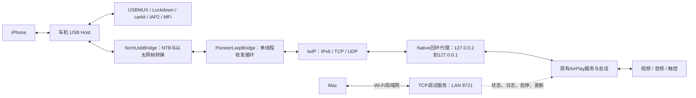
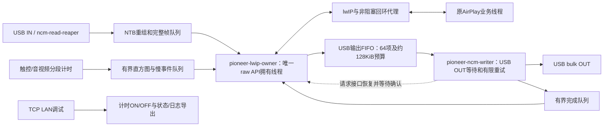

# DiPlay 接入 lwIP 后的技术架构与性能卡点

更新日期：2026-10-14。第1—12节保留 `0.2.18-pioneer-lwip5-hud-test`（versionCode 48）的架构与真机基线；第17节记录按评审方案完成的 `0.2.19-pioneer-lwip6-hud-test`（versionCode 49）实现。新版尚未安装到车机验证。

本文第1—12节记录优化前的架构、实现与实测边界；第13—15节为评审后的优化设计、计时要求和验收建议；实现情况及尚待实测的边界见第17节。目标是稳定建立连接，并限制触控、音视频各阶段积压带来的交互延迟。

## 1. 接入范围与当前结论

原方案把 iPhone 的 USB 网络数据送进 Android 的 VPN/TUN 接口，再由系统网络栈交给 DiPlay。本车机上，手机 TCP 建连请求进入 TUN 后没有正常回应；系统防火墙脚本也没有放行 `tun0`，因此改为由 APP 处理手机侧网络协议。

现在 **lwIP 处理手机侧 IPv6、TCP、UDP，再通过本机回环 socket，把数据交给原有 AirPlay 代码**。USB 接管、配对、iAP2/MFi、AirPlay 加密、音视频处理继续使用原有逻辑及已有适配。

不创建 TUN、不依赖 VPN 授权；但仍使用 Android 的本机 socket 和媒体接口。绕开的是 TUN 路由与过滤，不能理解成完全不使用 Android 网络栈。

`lwip3` 版已建立完整有线 CarPlay并显示画面；当前 `lwip5` 版配对及认证通过，但 USB 网络发送持续超时，未恢复画面。**路线可行已证实，重连稳定性和性能改善尚未证实。**

## 2. 整体架构



USB 有两条不同用途的通道：

| 通道 | 用途 | lwIP是否处理 |
| --- | --- | --- |
| USBMUX控制通道，当前接口1 | 信任、配对、carkit、iAP2/MFi、发起CarPlay | 不处理 |
| NCM网络通道，当前接口3/4 | AirPlay控制、事件、视频、音频、时间同步等 | 处理 |

“认证成功”不能保证 NCM 发送已恢复，本轮就卡在两者之间。

## 3. 启动顺序

1. 发现手机，取得 Android USB 授权。
2. 确认实际配置。首次切换时直接断开已识别内核驱动，立即切到 CarPlay配置6，再读回确认；当前已是配置6时复用。
3. 申请并持续持有接口1、3、4，选择数据接口4的 alternate setting 1。借用 Android授权FD，不要求root。
4. 新握手前清理 USBMUX残留，完成 Lockdown配对，打开 carkit和iAP2控制通道。
5. `CarPlayVpnService.attach()` 进入 lwIP分支，启动本机 AirPlay监听和桥接线程。保留类名，但不调用 VPN `Builder.establish()`。
6. lwIP创建手机侧链路本地地址，当前为 `fe80::2`；AirPlay默认监听 `127.0.0.1:7000`。若端口回退，应以实际 boundPort 为准。
7. 完成 iAP2/MFi认证，收到 `0x4300` 有线可用通知，发出 `0x4301`，告知手机连接地址与端口。
8. 手机完成邻居发现、TCP建连；原 AirPlay处理加密及 SETUP，建立事件、视频和音频通道。

“网络attach成功”只表示本机服务和桥接初始化完成，不表示USB已写出，更不表示手机已显示CarPlay。

## 4. 接收：iPhone → 车机

### 4.1 USB到lwIP

```text
iPhone以太网帧 → NCM NTB → USB bulk IN 0x88
  → UsbRequest/direct buffer → NTB拼接与解析
  → 完整以太网帧 → JNI input() → lwIP pbuf → ethernet_input()
```

USB读取可能把NTB拆开或合并，NTB也可能含多帧，所以 `NcmUsbBridge` 负责重组，不能将每次USB读取直接当作一帧网络包。

Android 7没有带超时的 `requestWait()`：`ncm-read-reaper` 辅助线程等待请求完成，桥接线程从完成队列等待结果。轮询超时后请求继续排在USB队列中，不会每次取消重建。完成后，将direct buffer内容交给NTB解析；完整帧经JNI复制到pbuf，由lwIP解析IPv6、邻居发现、TCP、UDP。

### 4.2 TCP：转发字节，而非直接转发原TCP包

```text
手机IPv6 TCP → lwIP接收/重组 → native接收缓冲
  → 非阻塞send() → 127.0.0.2:临时端口到127.0.0.1:业务端口
  → 原Java socket → AirPlay控制/事件/视频
```

**手机到lwIP、native到Java，是两条独立TCP连接。** 手机侧序号、重传、窗口由lwIP处理，本机侧由Android处理；代理只在中间转发字节，不是简单修改IP包头。

接受手机TCP后，native建立非阻塞回环socket，用 `127.0.0.2` 作为代理源地址，连接原服务的 `127.0.0.1:同一目标端口`。Java看到一致的对端地址，但本机TCP源端口为临时端口，不保留手机原源端口。

接收缓冲不足时raw回调返回 `ERR_MEM`，不丢弃这份TCP数据。数据实际写入本机socket后才调用 `tcp_recved()`，恢复手机侧接收窗口，防止Java消费慢时无限积压。这不意味着TCP ACK必须等到画面处理完成才发。

### 4.3 UDP：保留报文边界与手机源端口

```text
手机IPv6 UDP，源P/目标H → lwIP UDP回调
  → 127.0.0.2:P到127.0.0.1:H → 原DatagramSocket
```

UDP代理在 `127.0.0.2:P` 绑定手机源端口，使原代码能向相同代理地址/端口回复。UDP没有TCP的窗口背压及重传；当前分配或本机发送失败不提供可靠重试队列。

## 5. 发送：车机 → iPhone

### 5.1 业务数据到lwIP

TCP：原AirPlay向回环socket写加密字节；native非阻塞读取，根据lwIP可用发送空间调用 `tcp_write(..., TCP_WRITE_FLAG_COPY)` 和 `tcp_output()`。

UDP：业务向 `127.0.0.2:P` 发报文；native读取后按本机源端口找到lwIP UDP端点，通过 `udp_sendto()` 发往手机IPv6的端口P。NTP、麦克风等主动发往手机的UDP端口，经轻量登记调用排队，由桥接线程创建代理socket。

### 5.2 lwIP到USB

```text
lwIP生成以太网帧 → link_output()复制到native输出队列
  → JNI output()取出一帧并转成Java byte[]
  → NcmUsbBridge.send()封装NTB16
  → native USBDEVFS_BULK → USB bulk OUT 0x06 → iPhone
```

当前目标车机使用native USB写入：先复制Java数组到native内存，再等待内核调用，避免等待期间持续持有Java数组的critical访问。**仍是同步等待，不是异步USB发送。** 其他设备保留Android bulkTransfer路径。

失败帧留在 `pendingOutput`，下一轮优先重试；完整NTB写入成功才增加 `framesTxCompleted`。该计数表示USB调用完成，不证明手机上层已经处理。

## 6. 动态端口发现

原AirPlay动态创建事件、视频、音频等端口。为减少原代码改动，native目前每约100ms扫描 `/proc/net/tcp`、`tcp6`、`udp`、`udp6`，映射本APP UID的TCP监听和UDP端口。

收到TCP SYN会立即额外刷新TCP映射；收到未知目标UDP端口会额外刷新UDP映射，减小SETUP刚公布端口、周期扫描尚未运行的竞态。

排除TCP调试端口和代理自身的 `127.0.0.2` 端口。当前不是按CarPlay用途逐一白名单注册，已添加映射主要在整条链路关闭时清理。后续可用显式注册/注销减少扫描和端口累积，但尚未证明它是当前失败根因。

## 7. 线程与交接

| 线程/执行器 | 工作 | 交接方式 |
| --- | --- | --- |
| Android主线程 | 界面、触摸、Surface生命周期 | 触控提交后台，不直接等待触控网络写入 |
| Controller主执行器 | 配对、认证、有线iAP2控制循环 | 将NCM所有权交给网络服务 |
| `ncm-read-reaper` | Android 7 USB请求完成回收 | 完成队列；不调用lwIP |
| `pioneer-lwip-ncm` | 收包、lwIP、定时器、代理、USB发送、清理 | 所有raw API在此线程执行 |
| `airplay-accept` | 接受回环TCP连接 | 创建AirPlaySession |
| `airplay-control`及事件线程 | AirPlay控制、事件收取、保活 | 创建媒体流，处理业务 |
| `airplay-screen` | 视频读取、解密、码流转换 | 提交视频解码队列 |
| `carplay-video` | 解码配置、送帧、输出和恢复 | 当前模式执行解码工作 |
| `carplay-video-output`，按模式启用 | 独立取出并释放输出 | 并非每次连接都启用 |
| 触控单线程执行器 | 按序发送触控及部分其他控制任务 | 事件写锁、编码、加密、socket写入 |
| `airplay-audio-rx` / `airplay-rtcp-rx` | 音频数据和控制接收 | 交给音频处理/播放 |
| `carplay-audio` | 音频解码和AudioTrack写入 | 播放写入可能阻塞此线程 |
| `airplay-ntp-rx` / `airplay-ntp-tx` | 时间同步 | 回环UDP代理 |
| TCP调试监听及3个工作线程 | 状态、日志、报告、启停、APK上传 | LAN socket；启停交给应用生命周期 |

表中是职责划分，线程数量随媒体流和会话变化。

### lwIP线程每轮的实际顺序

```text
while running:
    NCM.recv(5ms)，有完整帧就input
    消费手机UDP端口登记队列
    lwIP.poll：
        到期则扫描端口
        sys_check_timeouts：协议定时器
        遍历TCP连接，非阻塞回环读写
        收回环UDP，提交lwIP
    最多尝试256次网络帧发送：
        优先pendingOutput，否则取native输出队列
        当前USB写入等待参数20ms
        失败保留帧并退出本轮发送阶段
    取诊断消息；约5秒记录一次计数
```

配置是raw API、`NO_SYS=1`，没有lwIP自带的 `tcpip_thread`、socket或netconn API。Android仍负责线程调度；当前没有为拥有线程设置实时调度或明确的高优先级。

**不能随意让多个线程并发调用当前raw API或访问native全局状态。** 改成异步USB发送时，应通过队列把完成结果交回拥有线程，不能在完成线程直接操作lwIP TCP对象。

## 8. 缓冲与背压

| 位置 | 当前行为/限制 | 影响 |
| --- | --- | --- |
| NCM完整帧队列 | 最多256帧、1MiB | 超限进入错误处理，避免无限积压 |
| 每条native TCP接收缓冲 | 256KiB | Java消费慢时，通过窗口背压限制手机继续发送 |
| 每条native TCP发送暂存 | 16KiB | 配合lwIP可用发送空间分批转发 |
| native TCP连接 | 最多48条 | 超限无法继续接受 |
| native以太网输出队列 | 最多1024帧 | 满时返回ERR_MEM |
| Java pendingOutput | 保留一帧并优先重试 | 防止超时静默丢帧，但挡住后续输出 |
| lwIP容量 | 配置内存池8MiB、TCP发送缓冲256KiB等 | 还有固定结构、malloc、pbuf、Java内存，整个桥接不只占8MiB |
| 触控执行器 | 单线程通用任务队列，逐任务提交 | 慢发送可能使后续操作排队；尚未专门合并移动事件 |
| 视频解码队列 | 沿用VideoDecodeQueue和积压恢复 | 要区分入队等待、解码和显示 |

当前输出没有触控、ACK、邻居回应等优先级。同一失败帧挡住后续输出；接收和定时器仍在后续循环运行，但同步发送等待会推迟下一轮。每轮上限是256帧，不代表实际每轮都发这么多，也不保证循环耗时上限。

## 9. 耗时卡点与证据

| 卡点 | 当前依据 | 解决方向 |
| --- | --- | --- |
| USB发送不恢复 | 本轮接收126帧、完整发送0、重试2770，返回-110超时 | 单独对照100ms等待、Android/native发送、接口重初始化 |
| USB等待阻塞桥接 | 同步写入代码确定存在；成功时贡献未量化 | 记录每轮及读写耗时，再评估异步写入 |
| 发送批次推迟接收 | 按256帧数量限制而非总耗时 | 记录批次耗时，评估按时间预算交替收发 |
| 视频解密慢 | 成功日志各窗口平均耗时中位数10.8ms，有较大峰值 | 原生实现已接入并通过正确性自检，收益待恢复画面后测量 |
| 解码管线延迟 | 入解码器到取出输出，各窗口p50中位数62ms、p90中位数约126ms | 分辨率和输出模式独立对照；已使用硬件解码 |
| 触控任务耗时 | 个别发送超过100ms，约217ms；排队未计时 | 拆分排队、锁等待、编码/加密、写入；必要时合并移动事件 |
| 复制与分配 | pbuf、native缓冲、JNI数组、NTB、解密均有复制 | 先采样，再考虑环形缓冲和buffer复用，贡献尚未测量 |
| 周期端口扫描 | 每约100ms读4份proc文件 | 测量开销；必要时显式注册或降低频率 |
| 日志与报告开销 | 诊断会增加工作，贡献未测量 | 降低日志量独立对照；性能测量时避免频繁导出报告 |
| 内存与GC | 曾遇导出返回内存不足；本轮无画面时Java堆约12MB/128MB | 恢复视频后观察GC和反复重连增长，当前快照不能证明泄漏存在或已修复 |

首次成功显示帧率的窗口中位数约24fps；它按解码输出释放计数，不是外部相机测量。手机静态画面可能少发帧，低帧率窗口不能单独证明解码性能不足。

## 10. 耗时指标的边界

```text
触摸产生 → 触控任务排队                   [touchSendMax不包含排队]
  → 开始sendTouch → 锁/编码/加密/socket写入 [touchSendMax主要覆盖发送流程]
  → 代理/lwIP/USB/手机 → 下一帧提交媒体     [touch2frame近似止于此]
  → 解码队列 → 入解码器 → 取出输出         [decode p50/p90覆盖入到出]
  → 释放到Surface → 合成 → 屏幕显示         [现有指标未完整覆盖]
```

`touch2frame`不确认下一帧由此次操作产生，不包括触控执行前排队及后续完整显示时间，不能当作准确的点击到画面变化耗时。

`decryptAvgUs`统计一次视频payload解密；`decode p50/p90`统计帧入解码器到取出输出，包含管线等待。各项边界不同，不能直接相加成完整延迟。

下一轮按第14节补充建连、USB/lwIP、触控、视频、音频及重连清理的分段计时。真实响应使用录像补充；内部阶段耗时与屏幕实际显示耗时分别报告。

## 11. 生命周期与重连

服务关闭时先关闭AirPlay监听及会话，再关闭桥接。桥接设置停止标记，关闭NCM唤醒读取，等待拥有线程退出；线程在finally内清理native状态。

native释放代理socket、已接受及未接受TCP状态、TIME_WAIT、UDP、网络接口、输出队列。NCM取消读请求、释放接口、关闭连接。lwIP全局初始化一次，每轮重新创建链路状态；当前只支持一条活动lwIP连接。

APP侧清理不证明手机及USB控制器已恢复。当前“已在配置6则复用”和网络接口重初始化要独立对照。残留清理本轮帮助USBMUX握手通过，但发送恢复仍失败。

当前重发 `0x4301` 要求 `firstTxReady=true` 且未接受TCP。该标志只表示至少一帧完整写出；若始终写不出，就不会执行启动重试，是明确的恢复盲区，但首次请求是否未生效仍需实测。

## 12. 代码入口与维护边界

以下相对 `DiPlay/`：

| 路径 | 职责 |
| --- | --- |
| `pioneer-adapter/src/main/cpp/pioneer_lwip.c` | raw协议、TCP/UDP代理、发现端口、邻居学习、队列、清理 |
| `pioneer-adapter/src/main/cpp/lwip-port/lwipopts.h` | 协议与容量配置 |
| `pioneer-adapter/src/main/cpp/pioneer_usb.c` | 授权FD上的接管、切配置、native写入 |
| `pioneer-adapter/src/main/cpp/pioneer_crypto.c` | 原生加密JNI |
| `pioneer-adapter/src/main/java/com/shilapi/xcertplay/pioneer/PioneerLwipRuntime.kt` | 开关、状态、UDP登记队列 |
| `shared/src/main/java/com/shilapi/xcertplay/network/PioneerLwipBridge.kt` | 拥有线程、收发调度、重试、生命周期 |
| `shared/src/main/java/com/shilapi/xcertplay/network/CarPlayVpnService.kt` | 路线分支及AirPlay服务所有权 |
| `shared/src/main/java/com/shilapi/xcertplay/transport/NcmUsbBridge.kt` | USB读写和NTB处理 |
| `shared/src/main/java/com/shilapi/xcertplay/transport/UsbRequestQueue.kt` | Android 7请求完成辅助线程 |
| `shared/src/main/java/com/shilapi/xcertplay/orchestration/CarPlayController.kt` | 连接控制、配对认证、触控执行、重连 |
| `shared/src/main/java/com/shilapi/xcertplay/airplay/ScreenStream.kt` | 视频读取解密 |
| `shared/src/main/java/com/shilapi/xcertplay/airplay/AirPlaySession.kt` | AirPlay会话和事件/触控发送 |
| `shared/src/main/java/com/shilapi/xcertplay/media/AndroidMediaSink.kt` | 解码显示和音频输出 |
| `shared/src/main/java/com/shilapi/xcertplay/media/VideoStats.kt` | 视频/触控统计 |

优先在适配模块和PioneerLwipBridge内调整收发，保留AirPlay字节接口，减少同步上游冲突。定位到视频或触控瓶颈后，再小范围改对应业务。

原VPN路径保留对照，目标车机启用适配时默认lwIP，普通设备保留原方案。LAN调试独立于lwIP和VPN，停止CarPlay后仍能导出报告、上传同包同签名更新。

## 13. 优化方案与实施优先级

### 13.1 P0：分类处理USB失败，建立有边界的恢复机制

当前 `NcmUsbBridge.send()` 将全部非正返回值统一视作暂未就绪；native已经返回负errno，但上层没有利用。超时、设备断开、端点故障和内存不足不应执行相同的无限重试。

- 超时：在启动宽限期内有限重试，记录连续失败次数、持续时间和最后成功发送时间。超过无进展期限后升级恢复。
- 设备断开或FD失效：结束本轮会话，释放资源并重新发现设备。
- 端点故障：有限次恢复并记录结果；当前native遇EPIPE会尝试CLEAR_HALT，但还需要检查恢复结果并交给上层决策。
- 内存不足：记录分配失败及队列占用，停止扩大积压，必要时结束本轮会话。
- 部分写入：保持显式错误处理；不能将所有失败都当作“对端一个字节也没收到”。后续异步接口应记录完成状态和实际传输长度，明确NTB部分发送后的恢复策略。

`pendingOutput`保留帧只能避免应用立即遗失该帧，不能保证对端未收到部分数据，也不能替代协议恢复。发送持续失败后，应按“有限重试→接口重建→整轮会话重建”升级；各级设置次数上限、退避和最终失败状态，禁止永久停留在连接中。

恢复100ms写入等待仅作为与成功版一致的对照实验。它可能改善启动阶段容忍度，同时也可能延长拥有线程的阻塞，不能直接作为性能修复。

### 13.2 P0：按建连阶段判断进展与恢复

建议显式记录以下状态：

```text
设备发现/授权 → 配置及接口就绪 → 配对完成 → MFi认证完成
  → 启动请求已发送 → USB首次完整发送 → AirPlay控制连接建立
  → SETUP完成 → 首帧释放到Surface → 实际显示（外部验证）
```

以上是观测里程碑，部分底层事件可能交错发生；状态机应按实际协议前置条件推进，不强制把所有时间戳解释为严格串行步骤。

每个阶段定义截止时间、失败原因、允许的恢复动作和次数。认证完成后的“无USB发送进展”“USB正常但无AirPlay控制连接”“SETUP完成但无首帧”分别诊断，不用一个连接总超时覆盖所有问题。

重发 `0x4301` 不应仅依赖 `firstTxReady`；也不能简单删除条件后无限重发。应在认证和当前会话状态允许时有限重试，验证是否使NCM就绪，失败再升级恢复。记录控制端口的TCP连接及AirPlay握手状态，不能用任意TCP接受事件代替业务就绪。

每轮连接分配 `sessionId`，恢复尝试分配 `attemptId`。旧线程退出、USB请求取消、native资源清理完成之后才允许新拥有线程使用全局lwIP状态；异步完成和业务任务携带会话代号，拒绝过期回调污染新连接。

### 13.3 P1：限制桥接调度延迟，隔离USB写等待

当前每轮只向lwIP输入一帧，而发送最多256帧，收发调度不对称。先增加计时，再分两步调整：

1. 最小改动：收包、代理处理和发送均设帧数/字节数及时间预算。有接收积压时连续处理若干帧，再轮转到协议定时器、代理及发送；有待处理工作时避免不必要的固定等待。原生UDP轮询、端口扫描也计入预算，不能只约束Java发送循环。
2. 隔离等待：使用独立USB发送线程或异步请求，通过有界队列交接帧和完成结果。lwIP raw API、TCP对象和native协议状态仍只由拥有线程操作。

时间预算只能在一次同步调用结束后检查，无法打断正在进行的USB写入；因此仅缩小发送批次数不能彻底隔离阻塞。异步化需同时定义buffer所有权、在途请求上限、取消与退出顺序、错误上报及会话代号。

先保证各流公平获得服务，再评估控制事件、邻居发现、ACK和实时UDP的优先级。保持同一TCP流内顺序，避免高优先级流量使其他流量长期饥饿。

### 13.4 P1：触控合并与加密边界

触控实际发送路径为：

```text
触摸产生 → 触控执行器排队 → HID报告构造 → 等待eventWriteLock
  → bplist/RTSP编码及日志格式化 → 事件加密 → 本机socket写入
  → native代理 → lwIP → USB → iPhone处理
```

当前 `touchSendMax` 从HID报告构造完成后、调用发送函数前开始计时，覆盖写锁等待、命令编码、加密及socket写入，但不包含执行器排队、前面的HID构造及后续手机处理。约217ms的记录不能归因为加密耗时。

事件通道使用配对验证得到的共享密钥派生读写密钥，以ChaCha20-Poly1305加密和校验消息。密钥在通道建立时派生，每条消息推进计数器，不是每次触摸重新配对。USB传输不改变现有事件通道的加密格式，不能单方面移除加密。触摸发送侧主要执行加密；返回视频的解密是另一条处理路径，视频payload约10.8ms的历史统计不能套用到触摸消息。

优先核查排队、锁竞争和写入阻塞：USB等待会延后代理消费，积压传导到本机TCP后可能阻塞事件写入；写入又持有事件锁，可能拖慢后续事件。该路径在代码上成立，但需要分段计时确定各部分实际贡献。

优化要求：

- 对同一手势中尚未发送的连续MOVE保留最新状态，保留DOWN、UP、CANCEL及多指状态转换的顺序；禁止跨手势或会话合并。
- 触控队列有界，记录合并数、拒绝数和最老任务年龄。过载时必须保证触点释放语义，不能随意丢弃UP造成持续按下。
- 事件流保持串行写入，维护命令顺序和加密计数器。不能通过并发写同一socket绕开写锁。
- 写入持续无进展时关闭对应会话以解除阻塞，再按恢复状态机处理；清理旧会话待发送任务。
- 单独测量日志格式化和加密；若证实占比高，再减少日志构造、复用buffer或优化加密实现。

### 13.5 P1：显式注册端口并完善生命周期

当前TCP、UDP端口表各最多128项，只增加不注销，主要在整条链路关闭时清理。同一链路内反复创建媒体流时有旧映射积累和槽位耗尽风险，尚无实测证明已触发。

建议采用“本机绑定成功→向lwIP注册并确认完成→向手机公布端口”的顺序，媒体流关闭时注销监听映射并按会话生命周期处理关联资源。已有连接与监听映射分别管理，避免注销监听误伤仍需排空的数据。`/proc`扫描暂作兜底，记录耗时、补注册次数、映射数量和失败原因。

### 13.6 P1/P2：控制媒体和队列积压，再优化复制与容量

所有关键队列记录字节数、深度和最老数据年龄，以延迟预算决定处理方式，不能只扩大缓冲隐藏拥塞。

- 视频：记录读取、解密、入队、送入解码器、输出和Surface释放各阶段。积压超过预算时按关键帧恢复机制追赶，不能任意丢弃有参考依赖的压缩帧。原生解密、分辨率、输出模式分别对照。
- 音频：测量接收间隔、队列驻留、解码和AudioTrack写入，区分网络断续、处理不及时和播放阻塞；实时UDP不采用无限重试保存过期音频。
- TCP代理：保持已有窗口背压，测量每连接缓存及本机socket写入进展，不把 `tcp_recved()` 解释为手机已显示或播放。
- 输出队列：设置容量与年龄观测，持续拥塞触发恢复。不要未经协议分析丢弃TCP字节或任意重排同一流的帧。
- 复制、分配、GC和线程优先级放在采样之后优化，避免在瓶颈未定位时扩大内存或盲目提高调度优先级。

## 14. 关键节点耗时统计要求

本节是待实现的观测要求，不表示当前代码已有这些指标。计时应随最小可运行优化分批加入，并在改动前保留基线。

### 14.1 时间源、关联与统计口径

- Android与native内部耗时统一使用可比的单调时钟，例如 `System.nanoTime()` 与 `CLOCK_MONOTONIC`，接入时验证时钟域和单位。墙上时间只用于报告检索，不计算耗时；不直接与MotionEvent、媒体PTS或手机时间相减，必须先确认时间域或转换关系。
- 所有记录携带 `sessionId`、`attemptId`、阶段名和结果；连接增加 `connectionId`/流类型，触控增加本地 `touchId`/手势编号，视频增加本地 `frameId`，USB请求增加请求编号及字节数。编号仅用于本地诊断，不修改协议载荷。
- TCP可能拆包、合包，触控任务、TCP段、以太网帧和USB请求不是一一对应。需要关联时记录字节区间或批次关系；无法确定因果时明确标注近似，不能把“下一帧”直接认定为该触控的响应。
- 每5秒输出聚合指标：样本数、p50/p95/p99/max、错误数、超时数和队列峰值。采用有界直方图/环形采样；跨窗口汇总合并直方图或样本，不计算“各窗口p95的平均值”冒充总体p95。
- 保留少量慢事件上下文，记录该时刻队列、USB错误、CPU/GC等关联状态；限频且异步导出，不逐包写磁盘或输出完整载荷。分别统计成功与失败调用，避免只看成功样本掩盖故障。
- 嵌套指标标明包含关系，端到端和子阶段不能重复相加；不同事件、不同时间窗口的百分位数也不能直接相加。阈值触发日志不等于自动判定根因。

### 14.2 节点与计时边界

| 链路 | 指标/节点 | 起止边界及关联信息 | 用途与边界 |
| --- | --- | --- | --- |
| 建连 | 授权等待 | 发起授权→结果返回 | 用户交互单独统计，不计入协议处理性能 |
| 建连 | USB配置/接口准备 | 开始配置检查→claim及alternate setting完成 | 分开记录切配置、claim、接口初始化和返回码 |
| 建连 | 配对、MFi、启动 | 每阶段开始→完成/失败/超时 | 记录0x4300接收、0x4301发送及重试时间 |
| 建连 | 首次发送/控制连接/SETUP/首帧 | 从设备授权就绪及从启动请求分别记录里程碑偏移 | 首次USB完成、TCP接受、AirPlay握手、SETUP和首帧分别计数 |
| USB RX | 请求在途、回收与解析 | queue→完成回收→桥接消费→NTB解析完成 | 在途时间包含等待手机发送；解析完成再记完整帧等待input时间 |
| lwIP | input、poll与定时器间隔 | 调用前后；相邻sys_check_timeouts执行时间 | 分开记录端口扫描、TCP代理、UDP代理耗时与处理量 |
| 桥接 | 每轮耗时与调度空档 | 循环开始→结束；相邻收包/代理服务时间 | 区分等待时间、工作时间，记录每轮收发帧数 |
| USB TX | 排队、封装、提交与完成 | link_output入队→出队→NTB完成→写调用开始/结束 | 记录队列年龄、native复制耗时、请求长度、返回值、errno、重试次数 |
| TCP代理 | 双向积压与转发 | 接收字节入缓冲→写入另一侧被接受 | 每连接记录rx/tx字节、窗口/发送空间、EAGAIN及无进展时间；接受写入不等于手机处理 |
| 端口 | 注册与扫描 | 提交注册→拥有线程确认；扫描开始→结束 | 记录映射数量、注销数、槽位不足及公布端口前是否已注册 |
| 触控 | 排队/HID构造 | 回调收到触摸→提交→任务开始→报告完成 | 系统事件产生到回调的延迟需先统一事件时间域 |
| 触控 | 等锁/编码/日志/加密 | 等锁开始→取得锁；各处理步骤前后 | 单独记录加密输入大小与实际实现，区分冷启动和稳态 |
| 触控 | socket写入 | write开始→返回；flush单独计时 | 仅证明本机写入完成，不代表USB完成或手机执行 |
| 视频 | 接收、解密、转换 | 完整payload组装过程→解密开始/结束→码流转换完成 | 读取等待可能是手机没有新画面；区分首字节到完整payload和等待下一帧 |
| 视频 | 入队及解码 | 入队→出队→取得输入buffer→提交→输出 | 按frameId/可映射PTS关联；记录队列最老帧年龄及恢复次数 |
| 显示 | Surface提交与可观测渲染 | 输出buffer释放时间；支持时使用渲染回调 | Surface释放及回调不直接等同面板像素变化；真实点击响应以外部录像验证 |
| 音频 | 接收/排队/解码/播放写入 | 报文接收→解码队列→解码→AudioTrack.write返回 | 按流记录间隔、丢包/迟到、短写、阻塞和可用的underrun统计；写入完成不等于扬声器播放 |
| 清理 | 停止与资源释放 | stop→USB取消→线程退出→native/socket清理完成 | 记录超时、残留请求、FD/线程/端口数量，作为下一轮启动前置条件 |

### 14.3 诊断输出与定位顺序

报告至少包含：APK版本与开关、设备/系统、USB配置及端点、媒体参数、测试场景、会话阶段时间线、分段耗时分布、队列年龄/峰值、错误分类及恢复记录。性能对照固定分辨率、帧率、音频模式、线缆和操作场景，频繁导出报告不得混入正常性能样本。

建议按以下证据判断方向：

- 触控排队高、加密低：检查前序任务、事件锁及socket阻塞，优先控制队列。
- USB写入长、桥接服务空档长、代理积压同步增长：优先隔离USB等待，不能直接归因于加密。
- 加密本身长：核对输入大小、实现、CPU调度及GC，再对照原生实现。
- 视频入队等待高但解码处理稳定：优先处理上游突发和积压恢复。
- 解码输入到输出高：区分输入buffer等待、解码器内部积压、输出消费和Surface生命周期。
- 外部触控到显示慢而本地阶段均短：继续核查手机处理及实际呈现，不能用本地计时推断未观测部分。

## 15. 验证顺序与验收目标

执行顺序：恢复可重复的成功基线→加入最小分段计时→USB错误分类及启动恢复→桥接公平调度/隔离等待→触控排队和端口生命周期→解密、解码与媒体参数对照。一次只改变一个主要变量，保存对应版本、参数和日志。

以下是第一轮工程目标，需按车机基线校准，不代表已经达标：

| 目标 | 场景与验收建议 |
| --- | --- |
| 稳定连接 | 软件启停、物理拔插各连续30轮，目标各30/30成功；分别记录首次成功率、自动恢复后成功率及人工介入次数，自动恢复不能掩盖首轮失败 |
| 建连时延 | 从USB授权且设备就绪到首帧释放，建议p95≤10秒；首次信任配对、冷启动、热重连分别统计，录像抽查实际显示 |
| 有限恢复 | 先按基线确定各阶段超时及总恢复期限；每次故障都必须在期限内恢复或进入明确失败状态，不允许永久重试；记录恢复次数和总耗时 |
| 触控响应 | 固定可见反馈场景，用录像测量触摸到对应画面变化，建议p95≤150ms、p99≤250ms；内部touch2frame只作辅助。样本不足时报告原始分布，不宣称稳定p99 |
| 连续交互 | 地图拖动、列表滚动同时播放音频，统计超过250ms的画面停顿、触控积压及音频断续；静态画面的低fps不算卡顿证据 |
| 长时运行 | 连续运行至少2小时，比较稳定阶段内存、FD、线程、端口表及队列年龄趋势；目标无持续增长、无非预期断开和持续音画积压 |
| 故障恢复 | 覆盖建连中拔线、运行中拔线、快速启停及手机端结束会话；检查旧任务隔离和资源清理，不以软件启停替代真实拔插 |
| 观测开销 | 对照关闭详细诊断与开启聚合指标两种模式，确认计时本身没有显著恶化交互和吞吐；慢事件日志需限频 |

30轮和2小时用于第一轮工程验证，不构成长期可靠性保证。构建成功、加密自检或单次首帧成功都不能替代这些真机结果。

## 16. 相关证据

- [验证结果及接入路线](2026-10-14-先锋车机USB有线CarPlay验证结论与DiPlay接入路线.md)
- [重连失败与卡顿分析](2026-10-14-先锋有线CarPlay重连失败与卡顿分析.md)
- [首次完整连接成功记录](../../evidence/pioneer-usb-integration-20261014/lwIP有线CarPlay成功记录.md)
- 最新完整报告：`DiPlay/evidence/pioneer-usb-integration-20261014/下车前lwip5失败/完整报告.zip`
- 性能统计：`DiPlay/evidence/pioneer-usb-integration-20261014/下车前lwip5失败/首次成功性能统计.json`

第13—15节的评审建议在当时尚未实施；随后按本方案开发的结果见下节。历史实测结果仍以第16节原始证据为准，不能把新版构建或本机冒烟结果当成车机连接成功。


## 17. 按最新设计完成的实现（lwip6）

### 17.1 新版收发与线程结构



- `pioneer-lwip-owner`只调用raw lwIP和native代理。每个接收、发送调度段限制为32帧、64KiB、约2ms；单次调用返回后检查预算，不宣称硬实时保证。
- `pioneer-ncm-writer`独占USB OUT，按FIFO发送不可变帧，等待、重试和清除端点halt不再阻塞正常lwIP收发。写等待恢复为成功基线的100ms，这是一项待对照验证的参数选择。
- native每轮TCP代理约1ms；UDP代理总计最多64个报文、64KiB、约1ms，每个peer最多4个报文，再轮转。`/proc`扫描分批处理，每批最多64行、约1ms，完整轮次后休息1秒。预算不能打断正在执行的系统调用。
- native输出队列仍按FIFO，最多1024帧且1MiB。没有擅自重排同一TCP流，也没有将raw API移到多线程。
- 完成队列只有完整USB写入才推进发送成功计数；JNI提交或NTB封装不算完成。

### 17.2 已实现的恢复边界

| 环节 | 新行为 | 尚需真机核对 |
| --- | --- | --- |
| USB错误 | 区分超时、断开/无效FD、stall、内存不足、部分写入、未知错误；输出返回值、请求长度与耗时 | `-110`仍仅表示超时，不能据此断言NAK或线缆故障 |
| stall | 每次USB attachment最多两次CLEAR_HALT，并记录返回码；恢复失败结束本轮 | 实际车机端点halt行为 |
| 连续无发送进展 | 启动请求后约5秒触发一次NCM数据接口alt 0→1重建；约15秒仍无进展则失败 | 是否能恢复本车机热重连 |
| 部分NTB写入 | 正返回但长度不足立即结束本轮，避免将破损NTB当成成功或无字节传输来重放 | 负errno时内核未提供实际长度，不能保证对端未收到部分数据 |
| 0x4301 | 不再依赖firstTxReady；仅在认证后的控制循环中有限重发，目标车机每轮总请求最多4次，包含availability触发 | 是否能使NCM OUT重新就绪 |
| 阶段超时 | attach后90秒认证/启动未完成；MFi后20秒无启动请求；启动后20秒无USB完成、25秒无控制连接；控制接受后20秒无SETUP；SETUP后30秒无首帧 | 这些是初始工程阈值，需要依据实测校准 |
| 持续积压 | 启动宽限期后，native/USB输出最老帧超过10秒触发失败和恢复 | 正常交互下队列年龄分布 |
| 整轮恢复 | 复用原HostActivity整栈重建和等待旧controller清理流程；最多自动重建两次，恢复窗口120秒；耗尽后关闭controller并显示手动重试入口 | 真实拔插、前后台切换及界面重建；预算位于HostActivity，重新启动Activity会开启新窗口 |
| 清理 | 停止writer、取消IN、关闭连接、等待reaper/owner退出；raw状态清理完成才释放全局owner锁，清理失败时拒绝新owner | Android 7取消请求及快速启停的实际结果 |

这套机制把“永远正在打开CarPlay”变成可观测、可退出的阶段失败；还不能保证原来的USB OUT故障已经修复。接口恢复期间拥有线程短暂停止接收和代理，等待取消IN完成，不能把这段恢复时间解释为正常性能。

### 17.3 触控与端口生命周期

触控沿用原串行执行器；目标车机的执行器队列限制128项，触控自身最多64项。同一会话、同一手势、相同触点按下状态的相邻未发送MOVE可合并为最新位置。DOWN、UP、CANCEL、多指转换和其他事件命令构成边界，不能跨边界合并。

过载时结束对应会话并拒绝该会话继续排队，利用会话结束释放触点状态，避免丢UP后持续按下。关闭会话时取消旧触控任务。事件socket写入超过2秒，由独立watchdog先关闭该socket，解除阻塞，再清理会话；仍保持串行写入和原加密计数器。

主控制、事件、视频、RTP/RTCP、NTP、keepalive、缓冲音频、iAP tunnel、视频设置通道及麦克风UDP端口加入显式租约注册。绑定成功后等待owner确认注册，再返回可公布的端口；关闭socket后注销。租约只允许释放一次，并携带USB会话代号，过期关闭不能删除下一轮映射。注销TCP监听不主动关闭已接受的代理连接。native表使用固定槽位复用，兜底扫描映射有过期清理，UDP peer空闲60秒回收。

### 17.4 已加入的观测

- `sessionId`标识USB attachment；`attemptId`记录其中接口恢复尝试；`LWIP_LINK`关联原controllerAttempt。TCP日志带connectionId，USB带requestId，触控带touchId/gestureId，视频队列及慢解码事件带frameId/PTS。
- 里程碑包括接口就绪、配对、MFi、availability、启动请求、首次USB完整写入、实际主AirPlay控制socket接受、成功SETUP响应flush、主屏首个输出buffer释放。TCP任意端口accept不会触发业务就绪标志。
- 计时使用单调时钟；启动日志`LWIP_CLOCK`保留Java前后读数及native读数，上车后检查时钟域是否一致。没有把手机PTS或MotionEvent时间直接与nanoTime相减。
- 每5秒输出有界直方图的样本数、p50/p95/p99桶上界、max、错误数；百分位是近似值，不是不同窗口百分位的平均。原有`VideoStats`仍保留作历史对照。
- 指标覆盖USB IN在途（包括手机静默）、NTB解析、完整帧等待、lwIP input/poll、native扫描/TCP/UDP服务和定时器空档、native及writer队列年龄、NTB构建、native复制、USB ioctl、触控排队/HID/锁/编码/日志/加密/write/flush、视频完整body读取/解密/转换/提交/队列/输入buffer/codec流水线/Surface释放、音频解密/队列/处理及AudioTrack写入。
- `audio-handle-includes-write`和`audio-input-includes-output-write`包含其内部播放写入，不能与子阶段耗时相加。USB write总耗时也包含JNI复制和ioctl。完整payload读取包含手机发送等待；Surface释放不等于面板实际显示。
- USB失败每秒最多一条详细上下文；媒体慢事件全局每秒最多一条、队列最多16项。媒体线程不逐包写文件，由owner统一输出。
- TCP `status`新增session、attempt、控制端口和最多32条阶段时间线；完整报告仍复用LAN调试导出。媒体队列深度、字节数与最老数据年龄每秒采样，`sampledPeakDepth`是采样峰值，不能当成精确的全程峰值；时间戳用于识别停更样本。

可以通过原TCP客户端切换聚合计时，立即生效并保存设置：

```sh
# 使用已有的 --host、--port 和 DIPLAY_DEBUG_TOKEN；不在文档中保存口令。
python3 DiPlay/pioneer-adapter/tools/diplay_debug.py --host 车机IP lwip-diagnostics --mode OFF
python3 DiPlay/pioneer-adapter/tools/diplay_debug.py --host 车机IP lwip-diagnostics --mode ON
```

关闭聚合计时后保留阶段、恢复、错误和队列状态日志，便于进行观测开销对照；这不等于关闭整个APP所有原有诊断。

### 17.5 已验证与后续实测

本机目标APK构建和有针对性的原生/触控冒烟验证记录保存在[新版实现证据目录](../../evidence/pioneer-usb-integration-20261014/lwip6优化实现)。验证覆盖端口重复租约与300轮注册/注销、槽位复用、输出队列容量与清理、IPv6 SYN-ACK校验，以及触控MOVE合并、边界、旧任务取消和过载关闭。这些是Mac上的验证，不是车机连接轮次。

未安装新版到车机，没有30轮USB拔插、两小时持续运行或触控到实际画面的录像结果。原生解密继续复用此前实现，未改变分辨率、Surface模式、视频参考链恢复算法和音频播放策略；后续先用新计时确认瓶颈，再分别对照这些变量。真实显示、手机执行和扬声器播放时刻仍需外部观察，软件计时无法替代。

下一轮应按第15节先验证新线、0.5A和固定媒体参数下的建连/重连，确认没有清理失败与发送停滞；之后再测连续交互、队列年龄和观测开销，最后进行分辨率或解码模式对照。
